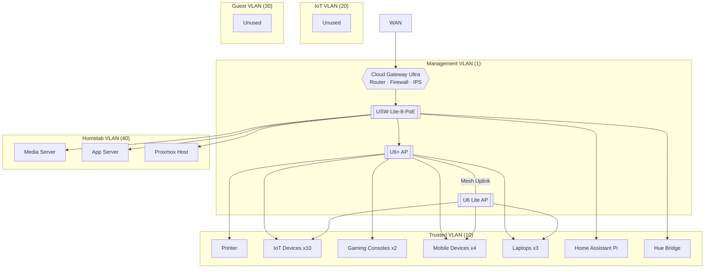

# Homelab

## Intro

This serves as a reference and inventory of my homelab setup: its current state and future work.

## Purpose

This homelab grew out of my experience taking down my home network experimenting with Pi-hole. I needed a way to segment my network and have a sandbox environment where misconfigurations were self-contained and other people and devices would not be affected. It has since evolved as a way to learn about networking, self-host applications and services, repurpose old hardware, and explore networking, security, and infrastructure concepts without running up an AWS bill.

## Architecture

## Network Overview

### VLAN Scheme

- **Management (1)** - Network devices (i.e. gateway, switches, access points, etc.)
- **Trusted (10)** - Personal devices, consoles, and IoT (planned migration to IoT VLAN)
- **IoT (20)** - Provisioned, migration planned
- **Guest (30)** - Provisioned, unused
- **Homelab (40)** - Servers, sandboxes

### Segmentation

- VLANs designed to be isolated from each other
- Inter-VLAN ALLOW from the network device list (tablet, Roku stick, Roku TV) which contains the devices running the Jellyfin client application (Trusted) --> Media Server (Homelab). Allow established/related return traffic
- IPv6 not configured

## Hardware

- **Gateway** - UniFi Cloud Gateway Ultra
- **Switch** - USW-Lite-8-PoE
- **Access Points** - U6+ & U6 Lite

## 24/7 Servers

### Raspberry Pi 4
Raspberry Pi 4 running Home Assistant OS. Currently supporting lighting automation with Philips Hue bulbs, Hue motion sensor, an Aqara presence sensor communicating over Zigbee, and Alexa speakers.

### 2017 MacBook Air
Ubuntu Server OS. Media server running self-hosted apps like Jellyfin in Docker containers. Accessible via Tailscale IP from devices on the tailnet. Jellyfin is also available via Roku stick and TV devices on the LAN via firewall rules in UniFi.

### 2018 MacBook Pro
Ubuntu Server OS. Running self-hosted apps/services:
- Todo list app (PWA, API/DB)
- Development todo list app (PWA, API/DB)
- Memos
- SilverBullet

### Dell Optiplex 5080
Proxmox VE hypervisor. Intel Core i5-10500T (6 cores / 12 threads), 32 GB RAM, 512 GB NVMe.
- **Wazuh** (long-lived VM): SIEM, with agents on the two Ubuntu servers.
- **Lab VMs** (short-lived): cloned from cloud-init templates for testing and labs, such as the Active Directory lab. Built with the scripts in [`proxmox/`](proxmox/).

## Remote Access

Remote access to the homelab is two-tiered: Tailscale P2P VPN access with SSH access bound to the Tailscale interface, and a Cloudflare Tunnel for HTTPS access to self-hosted services, such as the `minimal-todo` todo list PWA, accessed from my wife's and my phones via Cloudflare DNS. Using Cloudflare provides a clean DNS name as opposed to Tailscale DNS names or IPs, which are difficult to remember. It also allows HTTPS traffic to the public-facing apps on the MacBook Pro and provides OAuth integration for authentication.

Using Cloudflare Tunnels and not adding my wife's devices to the tailnet was a temporary, albeit incomplete, solution at the time, before adding ACLs to the tailnet. While ACLs on the tailnet are planned, I haven't decided whether I'll add her devices to the tailnet, as Cloudflare Tunnels are the less technical solution. The caveat is that Cloudflare terminates TLS on its servers, so a level of trust in Cloudflare is assumed. This two-tier pattern sidesteps port forwarding and open ports on the WAN.

### Tailscale
Tailscale provides an encrypted tunnel to communicate with specific devices on the network securely. Currently, there are no access control lists configured to prevent devices on the tailnet from communicating with each other. The devices currently on my tailnet are:
- Phone
- Raspberry Pi
- MacBook Air
- MacBook Pro
- Daily Laptop
- iPad

Tailscale allows me to securely access services running on the always-on homelab devices from my phone and laptop while I am away. Without access control lists, the devices running services are able to talk to my Home Assistant instance, which is not ideal.

### Cloudflare Tunnels
Cloudflare Tunnels allow HTTPS traffic to devices and services in the homelab without publicly associating my IP with my domain. The `cloudflared` daemon runs on the MacBook Pro and establishes an outbound connection to Cloudflare's edge servers. When HTTPS traffic arrives for the todo app's subdomain, Cloudflare forwards it as return traffic on that existing connection. This provides secure access to `minimal-todo` on an easy-to-remember domain and lets users like my wife use the application without adding their devices to the tailnet.

Current published routes/subdomains:
- ntfy - Self-hosted ntfy instance. No longer in use. Scheduled for decommissioning.
- dockge - Self-hosted Dockge instance. No longer in use. Scheduled for decommissioning.
- jobs - Route for ntfy channel messaging. No longer in use. Scheduled for decommissioning.
- todo - `minimal-todo` todo list application with Google OAuth and manual user provisioning/approval.

## Security
**IPS** - Block all Tor/Tor-associated traffic. In reviewing logs, I noticed a significant amount of traffic originating from Tor-associated IP addresses to two devices on the Homelab VLAN. IPS is configured to block all Tor traffic and traffic from Tor-associated IP addresses. I've identified Syncthing and the devices it runs on as a potential source, and plan to decommission Syncthing and monitor IPS to confirm this theory.

**DHCP Guarding** - DHCP guarding has been enabled on all VLANs to prevent rogue or unauthorized DHCP servers on the network.
